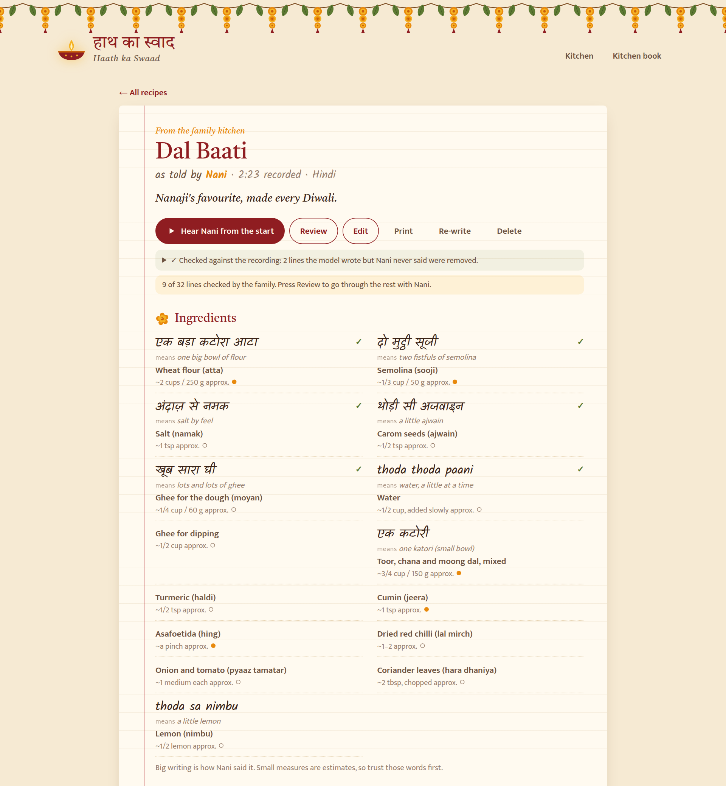
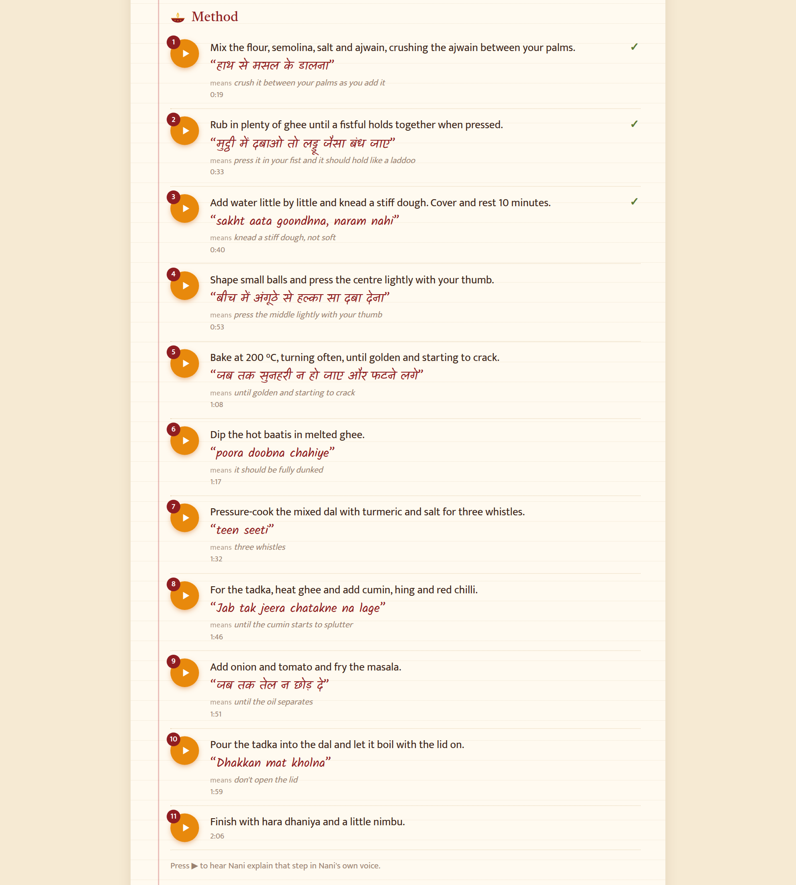
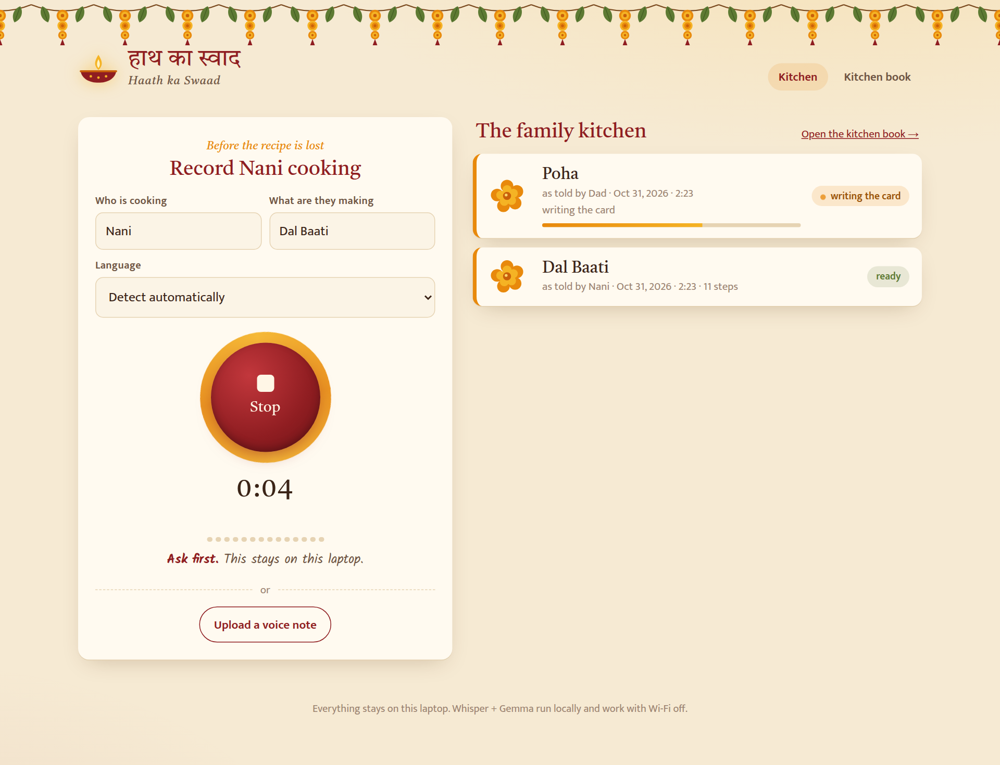
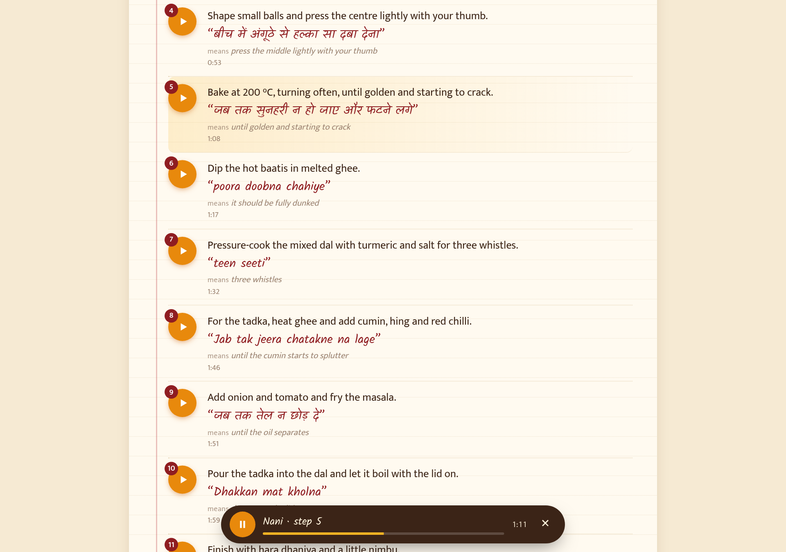
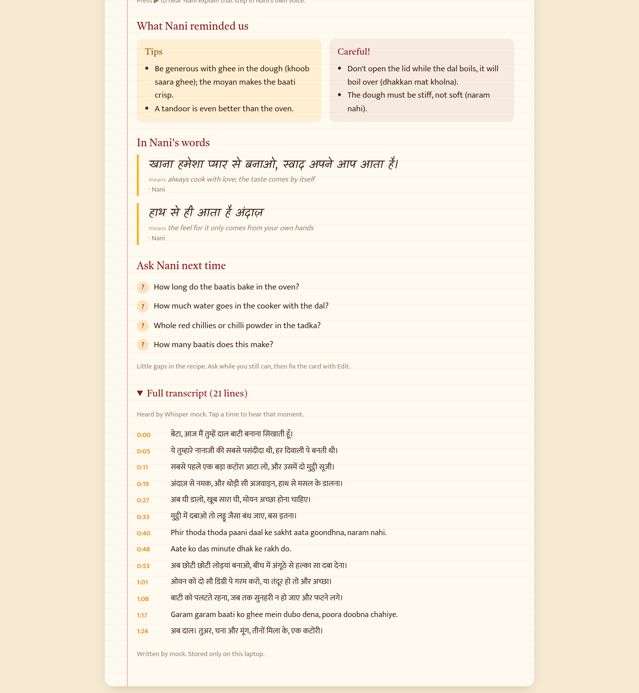
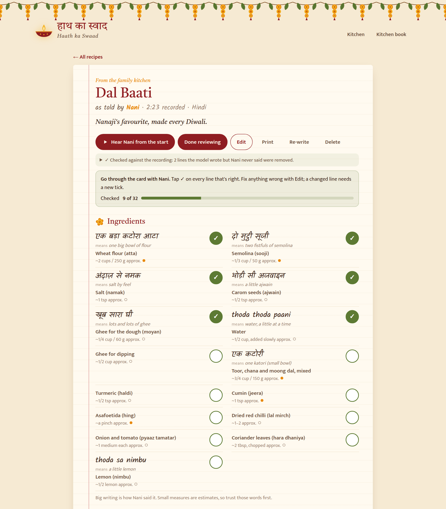
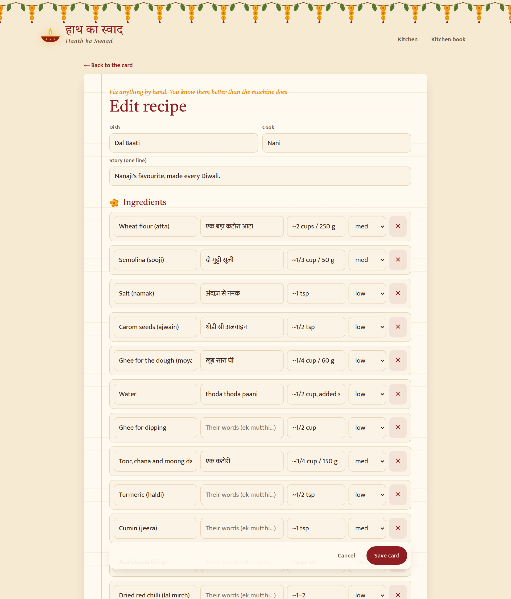
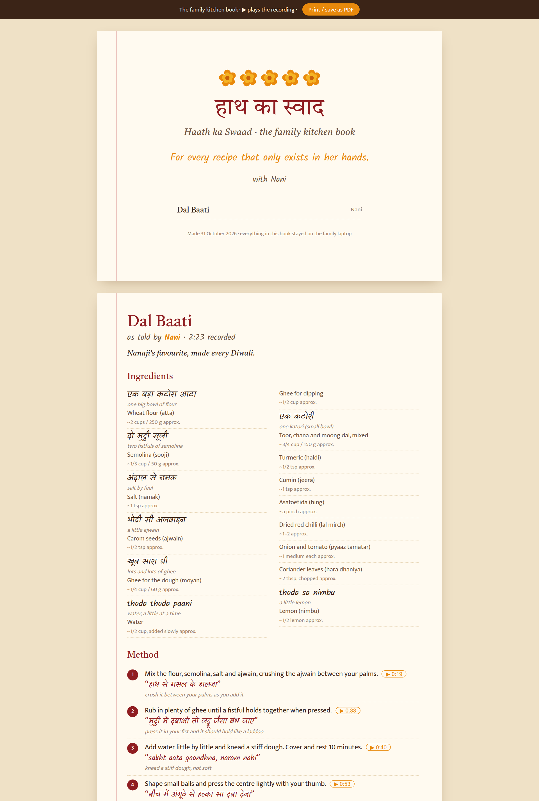
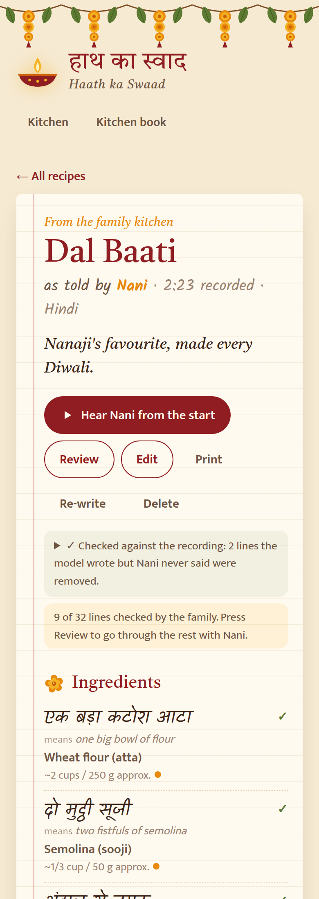
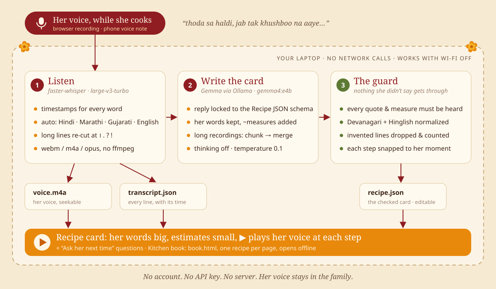

# हाथ का स्वाद · Haath ka Swaad

Haath ka Swaad: every family recipe, in the cook's own words and the cook's own voice

<p align="center"><b>▶ <a href="https://drive.google.com/file/d/1kej16GXMZ21pgoFzAF3P6nI_RkDgHIh0/view?usp=sharing">Watch the demo video</a></b></p>

**For every recipe that only exists in her hands.**

Record Mummy, Nani or Dadi cooking while she explains in Hindi, Marathi, Gujarati or Hinglish
(*"thoda sa haldi, jab tak khushboo na aaye"*), and get back a recipe card that keeps **her words**,
adds **approximate measures** beside them, and lets you press ▶ on any step to **hear her voice**
explain it. Everything runs on your laptop. Nothing leaves it.

---

## The problem

The best food in most Indian families was never written down. It lives in *andaaz*: "ek mutthi atta",
"namak andaaz se", "jab tak tel chhod de". When you ask for the recipe you get a shrug and
"bas, dekh ke seekh lo" (just watch and learn). And one day there is no one left to watch.

Recording a video helps, but a 40-minute video is not a recipe. Typing it up loses her voice.
Cloud transcription apps want an account, a subscription and your grandmother's voice on their servers.

## The solution

1. **Record** her cooking in the browser (or drop in a WhatsApp/phone voice note).
2. **faster-whisper** transcribes it on your laptop with timestamps, auto-detecting Hindi/Marathi/Gujarati/English.
3. **Gemma** (via **Ollama**, also on your laptop) turns the transcript into a recipe card:
   ingredients in her words + approximate measures, steps with her sensory cues, tips, warnings,
   memorable quotes, and a list of questions to *ask her next time*. Every phrase kept in
   Hindi/Marathi/Gujarati also gets a small English meaning underneath, for family who can't read the script.
4. An **anti-hallucination guard** checks every quote, measure and cue against the transcript and
   removes anything she never said. Each step is snapped to the moment she said it.
5. The **recipe card** shows her words big, the estimates small, and a ▶ button on every step that
   plays *her voice* from that moment. The **kitchen book** prints every recipe, one per page.
6. **Review** it together: tick each line once she confirms it. The card shows how much the family
   has checked, and changing a line takes its tick away, so a "family-checked" card means exactly that.

## Screenshots


**The family kitchen.** Record or upload a voice note on the left; every recipe on the right, with live status.



**The recipe card.** The cook's words in their own script, with an English meaning underneath and Gemma's `~` estimates beside them.



**The method.** Every step has a ▶ that plays the cook's voice from that moment.



**Recording.** The heading follows the cook's name; the screen stays awake.



**Playback.** The step lights up while it plays and stops at the next one.



**Notes.** Tips, quotes, "Ask next time" questions and the full transcript with tap-to-play times.



**Review.** Go through the card with the cook and tick each line. Edited lines need a fresh tick.



**Edit.** Fix anything Whisper or Gemma got wrong.



**Kitchen book.** One recipe per page, prints to PDF, works offline.



**On a phone** on the kitchen counter (`haath ui --lan`).

<sub>Screenshots use the built-in sample recipe (`haath ui --mock`), not a real family recording.</sub>

## How it works



<details>
<summary>Text version</summary>

```
   🎙  browser MediaRecorder / phone voice note
    │
    ▼
 ┌─────────────────────────────── your laptop ────────────────────────────────┐
 │                                                                            │
 │  original audio ──► faster-whisper (large-v3-turbo, CPU int8 / CUDA)       │
 │        │               segments + word timestamps + detected language      │
 │        │               long segments re-cut at sentence ends (। . ? !)     │
 │        │                          │                                        │
 │        │                          ▼                                        │
 │        │          Gemma via Ollama (format = Recipe JSON schema)           │
 │        │          long recordings: chunk → extract each → merge            │
 │        │                          │                                        │
 │        │                          ▼                                        │
 │        │          guard: every quote / her_words / her_cue must appear     │
 │        │          in the transcript (Devanagari + Hinglish normalized);    │
 │        │          steps snapped to the segment that contains them          │
 │        │                          │                                        │
 │        ▼                          ▼                                        │
 │  voice.m4a (seekable)      recipe.json ──► recipe card ▶ ──► book.html     │
 │                                                                            │
 └──────────────────── no network calls · works with Wi-Fi off ───────────────┘
```

</details>

One background worker handles one recording at a time, so Whisper and Gemma never fight over the CPU.
Each recipe lives in its own folder:

```
~/HaathKaSwaad/
├── book.html                    # haath book: opens offline by double-click
└── recipes/20261030-dal-baati-a734/
    ├── original.webm            # her voice, untouched
    ├── voice.m4a                # seekable copy for ▶ playback
    ├── transcript.json          # segments with timestamps
    ├── recipe.json              # the card (edit by hand in the UI)
    └── meta.json                # status, model used, what the guard removed
```

All writes are atomic (temp file + rename), so a closed laptop lid never leaves a broken recipe.

## Setup

You need Python 3.11+ and about 8 GB of free disk (models). No ffmpeg needed: audio decoding
comes bundled with faster-whisper (PyAV).

```bash
# 1. Ollama: https://ollama.com/download  (Linux: curl -fsSL https://ollama.com/install.sh | sh)
ollama pull gemma4:e4b

# 2. Haath ka Swaad (from this folder)
pipx install .               # or: uv tool install .
# Ubuntu/Debian: plain `pip install .` is blocked (PEP 668), use pipx (sudo apt install pipx)
# Then run once and open a new terminal so `haath` is on your PATH: pipx ensurepath

# 3. One-time Whisper download (~1.6 GB), then check everything
haath doctor --download

# 4. Open the kitchen
haath ui
```

After step 3 you can turn Wi-Fi off. `haath doctor` tells you exactly what's missing and how to fix it:

```
  ✓ faster-whisper + PyAV: PyAV 15.1.0 decodes webm/m4a/opus/mp3, no ffmpeg needed
  ✓ Whisper model large-v3-turbo: downloaded (works offline)
  ✗ Ollama server: not reachable at http://localhost:11434
      → run: ollama serve
```

**Try it without any models:** `haath ui --mock` (sample Dal Baati transcript + model reply).

## Using it

| Command | What it does |
|---|---|
| `haath ui [archive]` | Opens http://127.0.0.1:8767: record, watch status, read and edit cards |
| `haath ui --lan` | Also serves https on your Wi-Fi, so the phone on the kitchen counter can record too |
| `haath add voice.m4a --cook "Mummy" --dish "Dal Baati"` | Add an existing phone voice note |
| `haath list` | All recipes with status |
| `haath redo <id>` | Re-run Gemma (e.g. after `--model` change); `--full` also re-transcribes |
| `haath book` | Writes `book.html`: every recipe, printable, plays the cook's voice offline |
| `haath doctor` | Checks Whisper model, Ollama and the Gemma model |

**Flags:** `--lang hi|mr|gu|en`, `--whisper-model small`, `--model gemma4:e2b`, `--num-ctx 8192`,
`--archive PATH`. **Env:** `OLLAMA_HOST`, `HAATH_ARCHIVE`, `HAATH_MODEL`, `HAATH_WHISPER_MODEL`.

**Recording tips**

- Anyone who cooks: Mummy, Papa, Nani, Dadu, Chachi. The card uses their name everywhere.
- Ask first, and explain what it's for.
- Phone on the counter? Run `haath ui --lan`, open the printed `https://` address, accept the certificate once.
- Keep the mic ~1 m away, away from the cooker and exhaust fan.
- Ask them to *say* what they're doing ("kitna daala?", "kab tak?"). The card only uses what's said.
- Long recordings are fine; they're split and merged.
- Afterwards, actually ask the **Ask next time** questions.

**Speed.** On a CPU-only i5 laptop (16 GB, swapping), an 85-second clip took ~3 min in Whisper and
~12 min in Gemma. Too slow? Close heavy apps or use `--model gemma4:e2b --num-ctx 8192 --whisper-model small`.
A GPU helps a lot. You can close the tab while it works.

## Privacy

- **Nothing leaves your laptop.** No server ever hears the recordings.
- **Works offline** after the one-time model download. No CDNs; fonts are bundled.
- **No account, no subscription.** The archive is plain JSON + audio you can copy anywhere.
- **Open models.** Swap in any Whisper or Gemma with `--model …`, then `haath redo <id>`.

## Limitations

- **Dialects.** Strong regional accents and fast code-switching cause mistakes. Fix them with **Edit**.
- **Noise.** Cooker whistles, mixers and fans hurt accuracy.
- **Shared amounts.** "Teeno dal mila ke ek katori" is merged into one line only if a "together" word
  is said; otherwise each may show ~1 cup. The cook's own words are always shown beside it.
- **Measures are estimates.** `~` values are Gemma's guess; the cook's words come first.
- **The guard checks wording, not meaning.** Use **Review** with the cook to confirm each line.

## Development

```bash
python -m venv .venv && .venv/bin/pip install -e ".[dev]"
.venv/bin/pytest           # verification, snapping, parsing, merging, pipeline, API
.venv/bin/haath ui --mock  # full UI without Whisper or Ollama
```

## License

MIT, see [LICENSE](LICENSE). Bundled fonts (Kalam, Tiro Devanagari Hindi, Mukta) are under the
SIL Open Font License 1.1, see `src/haath/static/fonts/`.
